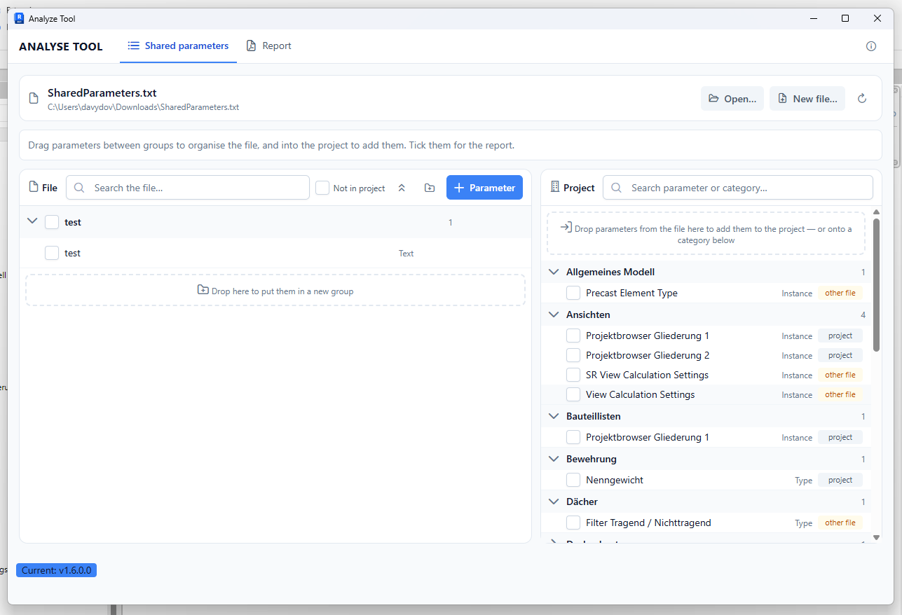
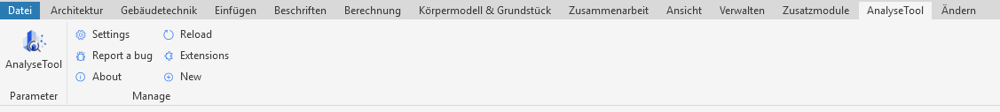
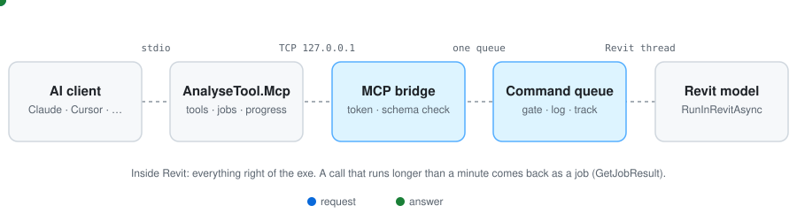
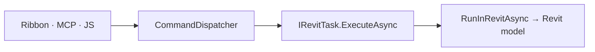
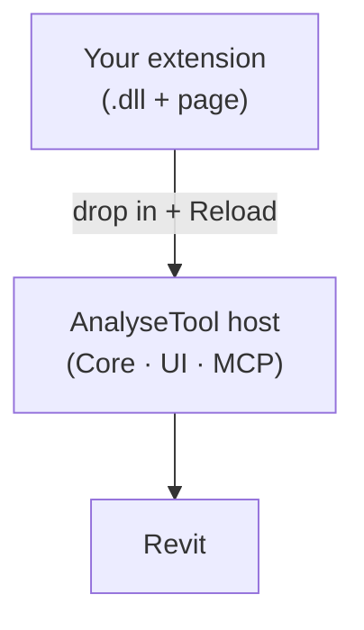
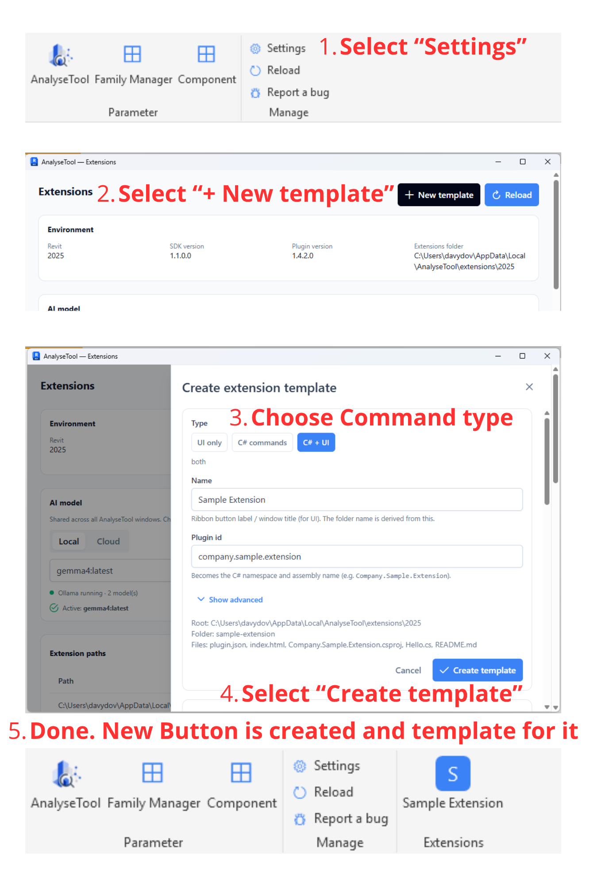

# AnalyseTool for Revit

[](https://github.com/Nikola1Davydov/AnalyzeTool/releases/latest)
[](https://github.com/Nikola1Davydov/AnalyzeTool/blob/main/LICENSE)

[](https://www.nuget.org/packages/AnalyseTool.Sdk)
[](https://linkedin.com/in/nikolai-davydov-4359bba1)

**A free Revit plugin for family & parameter workflows — and an open framework for building your own AI-powered Revit tools.**

Use the built-in tools (shared parameters and a printable parameter report) and installable packages, or build on top: write a command **once** and call it from the UI, from AI agents over MCP, and from your own panels. Connect the AI you already use (Claude, Cursor…) over MCP and let it work in Revit — and give the pages it builds a ribbon button.

<p align="center"></p>

---
## Quick start

1. **Install** — download the latest installer from [Releases](https://github.com/Nikola1Davydov/AnalyzeTool/releases/latest), close Revit, run it.
2. **Open** — start Revit → the **AnalyseTool** ribbon tab.
3. **(Optional) AI** — open **Settings**, turn on the MCP server and copy the client config into Claude Desktop, Cursor or any other MCP client.
4. **YouTube: https:**//www.youtube.com/@AnalyseTool-Revit

<details>
<summary><b>Compatibility, installation details & troubleshooting</b></summary>
### Installation
1. Download the installer from [Releases](https://github.com/Nikola1Davydov/AnalyzeTool/releases/latest) — pick **SingleUser** (current user, no admin) or **MultiUser** (all users, needs admin).
2. If you switch between SingleUser and MultiUser, **uninstall the previous AnalyseTool first** (otherwise you may end up with two copies / a duplicate ribbon).
3. Close Revit, then run the installer. Windows SmartScreen may warn "unknown publisher" (the build isn't code-signed yet) — choose **More info → Run anyway**.
4. Start Revit and open the **AnalyseTool** ribbon tab.

### AI setup
AnalyseTool has no AI of its own — you connect the one you already use. In **Settings → AI assistant**, turn the MCP server on, open *Connection details* and paste the config snippet into your client (Claude Desktop, Cursor, …). To let the assistant run C# in Revit and save pages for your extensions, turn on **C# execution** in the same block.

### Troubleshooting
- **Blank AnalyseTool window** → the WebView2 Runtime is missing; install it and restart Revit.
- **A new extension's ribbon button doesn't appear** → a brand-new button needs a Revit restart the first time; changing an existing extension only needs **Reload** on the ribbon.
- **Duplicate AnalyseTool tab / buttons** → both the SingleUser and MultiUser builds are installed; uninstall one.
- **AI tools don't update after toggling MCP** → the AI client caches the tool list; restart the client.
- **The AI client lists only `GetJobResult` and `CancelJob`** → it connected before the bridge was up. The bridge starts the first time you open AnalyseTool in a Revit session; open it once, then reconnect the server in your client.
- **Logs** for diagnosing anything: `%LOCALAPPDATA%\AnalyseTool\logs\analysetool-<date>.log`.
</details>

### Compatibility
- Revit 2025–2027 on Windows.
- Requires the **Microsoft Edge WebView2 Runtime** (present on most up-to-date Windows; the plugin prompts with a download link if it's missing).
---

## Two ways to use it

| 🧰 **Use it** | 🛠️ **Build on it** |
| --- | --- |
| Shared parameters and the parameter report built in; more tools as installable packages. | Shared commands · MCP server · dockable panes · a live extension system · a NuGet SDK. |
| Install the plugin and go. | *Write once, use everywhere.* Ship your own DLL — no host rebuild. |
| [→ Features](#-use-it--features) · [→ Quick start](#quick-start) | [→ Build on it](#-build-on-it--the-framework) |

---


# 🧰 Use it — Features


## The ribbon

<p align="center"></p>

Open the **AnalyseTool** tab:

- **AnalyseTool** — the main window: the shared parameters of your file and project in one table (create, edit, add to the project), and a printable A4 report of how well the chosen ones are filled.
- **Settings** — the AI connection (MCP) and the plugin's own switches.
- **Report a bug** — opens the GitHub issues page (works even if the plugin failed to load).
- **About** — versions, what's new and links to the source.
- **Reload** — reload extensions (DLLs + buttons) without restarting Revit.
- **Extensions** — install, update and manage extensions.
- **New** — create an extension: a ribbon button with a page and a C# command.
- Buttons of installed packages and of the extensions you or your AI added.

## 📊 Shared parameters & report

The main window (**AnalyseTool** on the ribbon):

- **One table** for the parameters of your shared parameter file and of the project.
- **Edit the file**: create, rename, regroup (drag into another group) and delete parameters. Saves keep a `.bak` and refuse to overwrite a file someone changed meanwhile.
- **Add to the project**: drop file parameters onto categories to bind them.
- **Report**: pick parameters — from a grouped picker, saved as named sets — and get A4 pages of filled vs empty, values and per-level counts, each as a chart, a table or both, ready to print.

## 🤖 AI — the one you already use

- Connect Claude Desktop, Cursor or any other **MCP** client: it reads and changes the model through AnalyseTool's commands — built-in and from your extensions.
- It can **try C#** against the open model (`ExecuteRevitCode`) and **give your extension a page** with a ribbon button. Code worth keeping goes into an extension — **New** on the ribbon scaffolds one.
- **Nothing runs code until you allow it:** running C# and saving pages is off until you switch it on in Settings, and the assistant cannot switch it on itself.

<p align="center"></p>

---


# 🛠️ Build on it — the framework

AnalyseTool isn't just a set of tools — it's a small framework for authoring Revit commands and UIs. You add your own **C# commands** and **web UI pages** **without rebuilding the plugin**: they drop into your extensions folder and load live on **Reload**.

## Build once. Use everywhere.

Write a command once as an `IRevitTask`. The dispatcher is transport-neutral, so the same command is instantly callable from **any WebView UI** — a window, the shared dockable pane, or an extension page, all via `AT.invoke` — and from **AI agents over MCP**. No duplicated logic.

<p align="center"></p>

## Command flow

Everything goes through one dispatcher, and the Revit model is only ever touched inside `RunInRevitAsync` (a valid API context on the Revit thread).



## AI, precisely

The **MCP server** exposes every command (built-in *and* your extensions) to external AI agents like Claude Desktop, so an agent can drive Revit through your commands. AnalyseTool itself runs no model. The path of one call is in the diagram above: the exe the client launches, a token-checked localhost bridge inside Revit, one command queue, the Revit thread. A call that outlives its wait comes back as a job the agent collects with `GetJobResult`, and progress reaches the client as it happens.

An agent can also **build with you**. It reads the authoring guide (`GetAuthoringGuide`), tries C# against the open model with `ExecuteRevitCode` — compiler errors come back to it, not to you — and saves a web page with a ribbon button for an extension's commands. Code worth keeping goes into the extension itself: a project (**New** scaffolds one), or C# sources in its `src\` folder, which AnalyseTool compiles on load. Every command publishes an input **and** an output schema, so the agent knows what to send and what shape comes back, instead of inferring either from prose.

## Extensions — plug in a DLL, don't fork the host

You don't modify AnalyseTool — you drop an extension next to it. It gets its own ribbon button and can open a window **or reuse the shared dockable pane** (`"dockable": true`). C# command DLLs and web UI pages are supported, and everything reloads live. An extension without a project — C# sources in its `src\` folder — is compiled by the plugin itself on load, no .NET SDK needed.



Prefer clicking to typing? **New** on the ribbon scaffolds a ready-to-build extension (UI-only, C#, or both) with a `plugin.json`, a sample command, and an `LLM.md` — and adds the ribbon button:

<p align="center"></p>

## Extension quick start (SDK)

```
dotnet add package AnalyseTool.Sdk
```

A command is one small class:

```csharp
using AnalyseTool.Sdk;

[RevitCommand(Description = "Counts the walls in the active document.", ReadOnly = true)]
public sealed class CountWalls : IRevitTask
{
    public Task<object?> ExecuteAsync(IRevitContext revitContext, CancellationToken cancellationToken) =>
        revitContext.RunInRevitAsync<object?>(app =>
        {
            var doc = app.ActiveUIDocument.Document;
            int count = new Autodesk.Revit.DB.FilteredElementCollector(doc)
                .OfClass(typeof(Autodesk.Revit.DB.Wall)).GetElementCount();
            return new { count };
        });
}
```


Add a `plugin.json`, build with a year config (`Release R25` / `R26` / `R27`), drop the output into
`%LOCALAPPDATA%\AnalyseTool\extensions\<id>\<RevitYear>\` (with `plugin.json` in `<id>\`), and hit **Reload**. Your command is now callable
from JavaScript (`AT.invoke("<id>.CountWalls")`) and from AI clients over MCP — no host rebuild.

📖 **Full authoring guide:** the [GitHub Wiki](https://github.com/Nikola1Davydov/AnalyzeTool/wiki) (mirrored from [`ONBOARDING.md`](ONBOARDING.md)) — the manifest, the SDK contract, deploy & live reload, MCP, and more. Writing with AI? Paste [`LLM.md`](src/LLM.md) into Claude/ChatGPT and it writes AnalyseTool extensions for you.

## Project structure

```
src/
  AnalyseTool.Sdk/        public SDK extension authors compile against (the only contract)
  AnalyseTool.Core/       platform: command queue & dispatcher, extension loader (ALC), Roslyn (ExecuteRevitCode, host-built extensions)
  AnalyseTool.Tools/      built-in feature commands in vertical slices (Actions/Elements/SharedParameters) — references ONLY the Sdk
  AnalyseTool.Mcp.Bridge/ in-Revit MCP transport (TCP bridge into the command queue)
  AnalyseTool.Mcp/        out-of-process MCP server the AI client launches (stdio ⇄ TCP)
  AnalyseTool.App/        host UI: windows, ribbon, dockable pane, WebView2 transport, bootstrap
  AnalyseTool.Launcher/   thin Revit add-in shim that loads the host in isolation
  clientapp/              Vue 3 + Vite + PrimeVue frontend
  Installer/              packaging & installation assets
samples/                  example extensions (Acme.Sample doubles as the SDK guardrail in CI)
```

Dependency contract (enforced by `src/build/Check-Boundaries.ps1` in CI): extensions and
`Tools` see only the `Sdk`; transports (`Mcp.Bridge`) plug into `Core` from outside; `App`
composes everything; `Core` and `Tools` are headless (no WPF).


## Feedback

Found a bug or have an idea? Use the [issue tracker](https://github.com/Nikola1Davydov/AnalyzeTool/issues) (or the **Report a bug** ribbon button) and attach the latest log from `%LOCALAPPDATA%\AnalyseTool\logs`. PRs welcome.

## License

AnalyseTool is licensed under the [Apache License 2.0](LICENSE), with one exception: the public extension SDK, [`AnalyseTool.Sdk`](src/AnalyseTool.Sdk), is licensed under the [MIT License](src/AnalyseTool.Sdk/LICENSE) so extension authors can consume it without any strings attached. Bundled third-party components are listed in [THIRD-PARTY-NOTICES.txt](THIRD-PARTY-NOTICES.txt).
