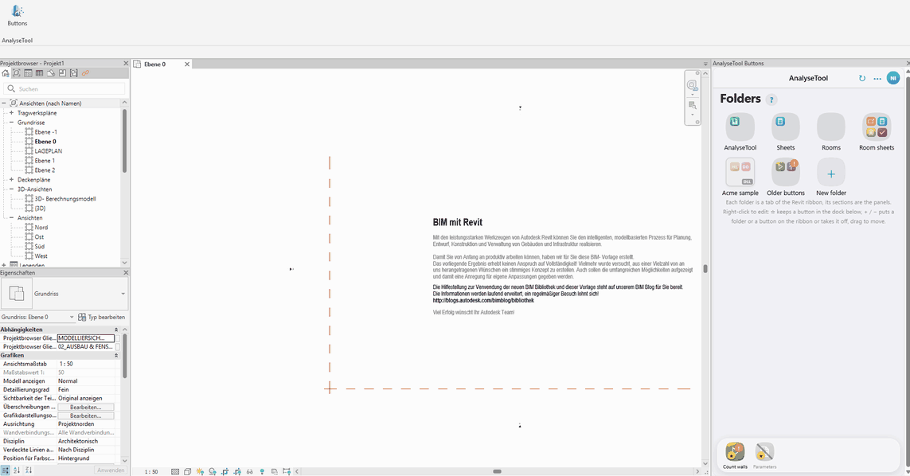
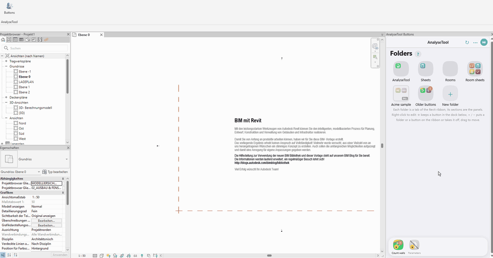
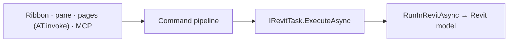

# AnalyseTool for Revit

[](https://github.com/Nikola1Davydov/AnalyzeTool/releases/latest)
[](https://github.com/Nikola1Davydov/AnalyzeTool/blob/main/LICENSE)

[](https://www.nuget.org/packages/AnalyseTool.Sdk)
[](https://linkedin.com/in/nikolai-davydov-4359bba1)

**Your own Revit buttons — C# that AnalyseTool compiles, with a version history each — and the AI you already use, working in Revit.**

AnalyseTool is a free Revit add-in. It brings shared parameters and a printable parameter report, and it is a place for your
own tools: a button is a folder with a C# file (and, if you like, a page); save the file and the button runs the new code.
Claude Code, Codex, Cursor or any MCP client can read and change the model through AnalyseTool — and write buttons with you.
**Model tests** check the open model like unit tests check code — required parameters, naming, ranges, clashes — with a
baseline of accepted failures, so only what is new fails.

<p align="center"></p>

---

## Quick start

1. **Install** — close Revit, run the installer from [Releases](https://github.com/Nikola1Davydov/AnalyzeTool/releases/latest).
   It replaces an installed AnalyseTool 1.x.
2. **Open** — in Revit, the **AnalyseTool** tab has one button, **Buttons**: the pane with everything.
3. **Make a button** — in the pane, **New folder** (a tab of the ribbon), then **New button**: it works at once, its C#
   is a file you (or your AI) edit.
4. **(Optional) AI** — profile (your initials, top right) › **AI clients**: two commands install the AnalyseTool plugin
   for Claude Code or Codex; other clients get a snippet to paste.
5. **(Optional) Model tests** — the **Tests** tab of the pane: **New folder** makes a folder of tests (`<name>.tests`)
   with an example suite; **Run** checks the model, every failure can be isolated, highlighted, repaired or accepted. The
   easiest way to write tests is to ask your AI client — the «?» on the tab explains the rest.

YouTube: https://www.youtube.com/@AnalyseTool-Revit

<details>
<summary><b>Installation details, compatibility & troubleshooting</b></summary>

### Installation

- **SingleUser** (this Windows user, no admin) or **MultiUser** (all users, needs admin). If you switch between them,
  uninstall the other first — otherwise two copies load.
- **AnalyseTool 1.x** installed with the installer of the same kind (SingleUser/MultiUser) is removed by the 2.0 installer.
  Your extension folders and settings in `%LOCALAPPDATA%\AnalyseTool\` stay.
- Windows SmartScreen may warn "unknown publisher" (not code-signed yet): **More info → Run anyway**.

### Compatibility

- Revit 2025, 2026, 2027 on Windows; the **Microsoft Edge WebView2 Runtime**.

### Troubleshooting

- **Blank pane or window** → the WebView2 Runtime is missing; install it and restart Revit. A page that fails shows its
  error and **Reload**.
- **A button is grey, has a «!» or an orange dot** → grey: off the ribbon (−/+ in the edit mode) or turned off; «!»: its
  C# does not compile (tap it: file, line, message — the last good build still runs); orange dot: its last run failed (tap
  it for the error).
- **An AI client does not answer** → AnalyseTool starts its MCP server the first time you open it in a Revit session:
  click **Buttons** once. A client that does not show a new command: reconnect it, or use `RunCommand`.
- **Logs**: `%LOCALAPPDATA%\AnalyseTool\logs\<year>\log-<date>.txt`.
</details>

---

## The pane

**Buttons** opens the pane, laid out like the home screen of a phone — and it is the map of your ribbon:

<p align="center"></p>

- **A folder is a tab of the Revit ribbon, its sections are the panels.** New folder, New button, + New panel — nothing to
  set by hand.
- **Right-click to edit**: drag a button between sections; drag it **up** to «into another folder» (the folders show, drop
  it on one) or **down** to the trash; drag a folder of yours to the trash too. **−/+** keeps a tab or a button off the
  ribbon (it stays in the pane, grey), **☆** keeps a button in the dock at the bottom, **✎** renames it, sets its page to
  open in the pane and shows its code, files and versions, **📁** opens its folder for an AI tool. **?** explains it all
  with pictures.

<p align="center"></p>

- **A command that needs a few values** gets a form in the pane, built from its input type; a page marked `dockable`
  opens inside the pane, any other in a window.
- **DLL projects** (built by their author) are boxes marked DLL, with the Revit years they are built for; their buttons
  run here, their author edits them. **Older buttons** holds folders with a `plugin.json` (AnalyseTool 1.x); ✎ › Move to…
  puts such a button into a tab.
- **The AnalyseTool folder** holds **Parameters**: the shared parameters of your file and project in one table, binding to
  categories, and a printable A4 report of how well chosen parameters are filled.
- **The profile** (your initials): **Statistics** (clicks, run times, failures — on this machine only), **Packages**
  (`.zip` extensions others shared), **AI clients**, **Folders of buttons** (add a network folder your team shares),
  **Report a bug**, **About** (the version, what is new; a dot on your initials when a newer version is out — AnalyseTool
  asks GitHub once a day which release is the latest; nothing else leaves the computer), tile size and theme
  (it follows Revit by default). **↻** reads every folder again.

## AI — the one you already use

AnalyseTool runs no model. Its **MCP server** runs inside Revit — `http://localhost:48075/mcp`, one address and one
token for every open Revit version — and gives an AI client the built-in commands and every command of your buttons.

- **Claude Code and Codex**: the AnalyseTool plugin ships with the add-in. Profile › AI clients shows the two commands
  (`claude plugin marketplace add "<add-in folder>\Plugin"` + `claude plugin install analysetool@analysetool`, or the
  same with `codex plugin …`). No token to copy; it brings the skills `revit` and `new-button`.
- **Cursor, VS Code, Claude Desktop, Gemini CLI**: a snippet with the address and the token to paste.
- **Several Revit versions open**: every tool takes `"revit": "2026"`; `ListRevitVersions` lists them; without it, a call
  goes to the Revit you used last.
- **It builds with you**: it reads the guide (`GetAuthoringGuide`), creates a button (`CreateExtension`), writes its C#
  (compiler errors come back with file and line), runs it (`RunCommand`, also for a command its tool list does not show
  yet) and saves a version. Every version is yours to compare, restore or pin.
- Only `localhost`, a token on every request, no request from a web page. Arbitrary C# (`ExecuteCode`) only after you
  turn on **Let AI clients run any C#** in profile › AI clients (off by default, at once, no restart).

---

## Build on it

### A button is a folder

```
%LOCALAPPDATA%\AnalyseTool\extensions\
  Sheets.tab\                     a tab of the ribbon
    Numbering.panel\              a panel
      Renumber.pushbutton\        one button, all of it in one folder:
        bundle.json                 its name, icon, tooltip
        Renumber.cs                 its command
        index.html                  its page (optional)
        .git\                       its versions
    _shared\*.cs                  optional: C# every button of the tab compiles with
```

The layout is pyRevit's: the folders are the ribbon. AnalyseTool compiles the C# itself, with its own Roslyn against the
running Revit — no .NET SDK, no project, no DLL. Save a file and the button runs the new code a moment later; a compile
error keeps the last good build running and shows where it is. Every button folder is a git repository: **save a
version**, see the history and the diff, **restore** (unsaved work becomes a version first) or **pin** the button to an
older version.

A command is one class:

```csharp
using AnalyseTool.Sdk;
using Autodesk.Revit.DB;

[RevitCommand(Description = "Counts the walls in the active document.", ReadOnly = true, OutputType = typeof(WallCount))]
public sealed class CountWalls : IRevitTask
{
    public Task<object?> ExecuteAsync(IRevitContext revitContext, CancellationToken cancellationToken) =>
        revitContext.RunInRevitAsync<object?>(app =>
        {
            var document = app.ActiveUIDocument.Document;
            return new WallCount { Count = new FilteredElementCollector(document).OfClass(typeof(Wall)).GetElementCount() };
        });
}

public sealed class WallCount
{
    public int Count { get; set; }
}
```

The same command runs from its button, from a page (`AT.invoke("sheets.walls.CountWalls")`) and from AI clients — no
host rebuild.

**A DLL project** is for what a button folder cannot do: NuGet packages with dependencies, native libraries, embedded
resources, closed code. It is a folder with a `plugin.json`, built per Revit year with `dotnet add package
AnalyseTool.Sdk` (`EnableDynamicLoading` copies its packages; AnalyseTool loads them).

📖 **The authoring guide**: [`LLM.md`](source/AnalyseTool.Extensions/Authoring/LLM.md) — the contract, where a button
lives, pages, transactions, DLL projects, migrating older folders. It ships next to the add-in; every button folder
has an `AGENTS.md` / `CLAUDE.md` pointing AI agents there. For people: [`ONBOARDING.md`](ONBOARDING.md) and the
[Wiki](https://github.com/Nikola1Davydov/AnalyzeTool/wiki).

### One pipeline



Every command goes through one pipeline (logging, the active document, progress, cancellation); the model is only
touched on the Revit thread, and every transaction starts and ends inside one `RunInRevitAsync`.

## Project structure

```
source/
  AnalyseTool.Sdk/                    the public contract of buttons (NuGet, MIT)
  AnalyseTool.Extensions/             buttons: tabs and button folders, Roslyn builds, DLL loading, live reload, git versions, packages
  AnalyseTool.Hosting/                command pipeline, Revit dispatcher, settings (template module)
  AnalyseTool.Hosting.Mcp/            MCP server inside Revit: one address for every Revit version
  AnalyseTool.Hosting.WebView/        WebView2 windows, the dock pane, extension pages
  AnalyseTool.Hosting.Scripting/      ExecuteCode / DescribeApi for agents
  AnalyseTool.Hosting.Visualization/  geometry drawn over views
  AnalyseTool/                        the add-in: ribbon, pane, built-in tools, React app (ClientApp/), Plugin/ for Claude Code and Codex
  AnalyseTool.Launcher/               thin Revit entry that loads the add-in in isolation
tests/                                Revit-free tests and tests inside Revit
build/  install/                      build pipeline (ModularPipelines) and installer (WixSharp)
samples/                              an example DLL project (Acme.Sample)
```

Built on the [davydov-revit template](https://github.com/Nikola1Davydov/Davydov.Revit.Template); the dependency contract
is enforced by `build/Check-Boundaries.ps1`.

## Feedback

Found a bug or have an idea? Use the [issue tracker](https://github.com/Nikola1Davydov/AnalyzeTool/issues) (or
**Report a bug** in the profile of the pane) and attach the latest log from `%LOCALAPPDATA%\AnalyseTool\logs`. PRs welcome.

## License

AnalyseTool is licensed under the [Apache License 2.0](LICENSE), with one exception: the public extension SDK,
[`AnalyseTool.Sdk`](source/AnalyseTool.Sdk), is licensed under the [MIT License](source/AnalyseTool.Sdk/LICENSE) so
extension authors can consume it without any strings attached. Bundled third-party components are listed in
[THIRD-PARTY-NOTICES.txt](THIRD-PARTY-NOTICES.txt).
