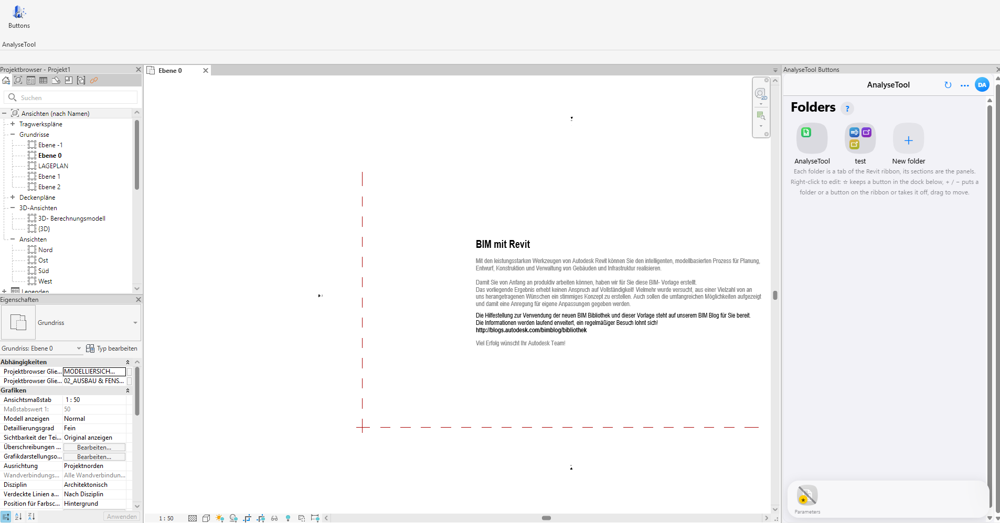
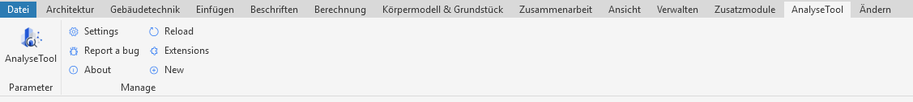
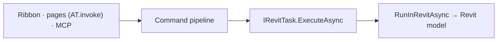
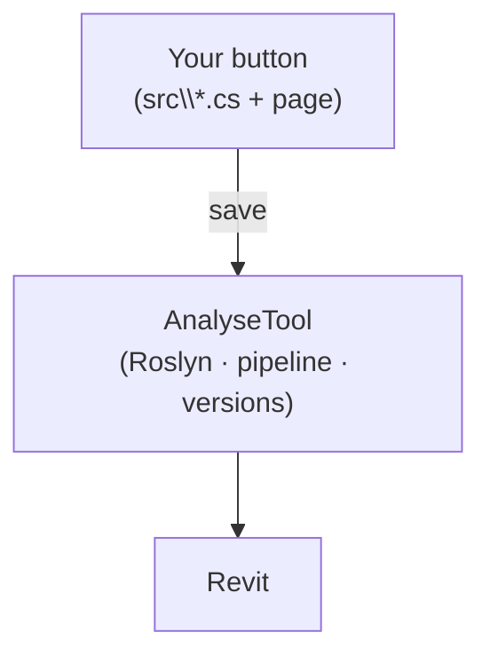

# AnalyseTool for Revit

[](https://github.com/Nikola1Davydov/AnalyzeTool/releases/latest)
[](https://github.com/Nikola1Davydov/AnalyzeTool/blob/main/LICENSE)

[](https://www.nuget.org/packages/AnalyseTool.Sdk)
[](https://linkedin.com/in/nikolai-davydov-4359bba1)

**A free Revit plugin for family & parameter workflows — and an open framework for building your own AI-powered Revit tools.**

Use the built-in tools (shared parameters and a printable parameter report) and installable packages, or build on top: write a command **once** and call it from the UI, from AI agents over MCP, and from your own panels. Connect the AI you already use (Claude, Cursor…) over MCP and let it work in Revit — and give the pages it builds a ribbon button.

<p align="center"></p>

---
## Quick start

1. **Install** — download the latest installer from [Releases](https://github.com/Nikola1Davydov/AnalyzeTool/releases/latest), close Revit, run it.
2. **Open** — start Revit → the **AnalyseTool** ribbon tab.
3. **(Optional) AI** — open **Settings**, turn on the MCP server and copy the client config into Claude Desktop, Cursor or any other MCP client.
4. **YouTube: https:**//www.youtube.com/@AnalyseTool-Revit

<details>
<summary><b>Compatibility, installation details & troubleshooting</b></summary>
### Installation
1. Download the installer from [Releases](https://github.com/Nikola1Davydov/AnalyzeTool/releases/latest) — pick **SingleUser** (current user, no admin) or **MultiUser** (all users, needs admin).
2. If you switch between SingleUser and MultiUser, **uninstall the previous AnalyseTool first** (otherwise you may end up with two copies / a duplicate ribbon).
3. Close Revit, then run the installer. Windows SmartScreen may warn "unknown publisher" (the build isn't code-signed yet) — choose **More info → Run anyway**.
4. Start Revit and open the **AnalyseTool** ribbon tab.

### AI setup
AnalyseTool has no AI of its own — you connect the one you already use. In **Settings**, turn the MCP server on (it starts with the next Revit) and copy the `claude mcp add …` command or the address and token into your client (Claude Code, Claude Desktop, Cursor, …). The server runs inside Revit over HTTP on localhost.

### Troubleshooting
- **Blank AnalyseTool window** → the WebView2 Runtime is missing; install it and restart Revit.
- **A button doesn't appear or does nothing** → open **Manage buttons**: the extension may be off, fail to compile (the error shows file and line) or have no build for this Revit year.
- **Duplicate AnalyseTool tab / buttons** → both the SingleUser and MultiUser builds are installed; uninstall one.
- **AI tools don't update after toggling MCP** → the AI client caches the tool list; restart the client.
- **Logs** for diagnosing anything: `%LOCALAPPDATA%\AnalyseTool\logs\<year>\log-<date>.txt`.
</details>

### Compatibility
- Revit 2025–2027 on Windows.
- Requires the **Microsoft Edge WebView2 Runtime**
---

## Two ways to use it

| 🧰 **Use it** | 🛠️ **Build on it** |
| --- | --- |
| Shared parameters and the parameter report built in; more tools as installable packages. | Shared commands · MCP server · dockable panes · a live extension system · a NuGet SDK. |
| Install the plugin and go. | *Write once, use everywhere.* A button is a C# file AnalyseTool compiles — with its own version history. |
| [→ Features](#-use-it--features) · [→ Quick start](#quick-start) | [→ Build on it](#-build-on-it--the-framework) |

---


# 🧰 Use it — Features


## The ribbon

<p align="center"></p>

The **AnalyseTool** tab keeps three buttons:

- **Buttons** — the pane, and the map of the ribbon: every **folder** is a tab of the Revit ribbon, its **sections** are the panels of that tab — the structure of the pane *is* the ribbon, nothing to set by hand. **New folder** makes a tab, **New button** in a section writes C# and a page that AnalyseTool compiles, each change a version. Right-click to edit: drag buttons between sections, **−/+** keeps a folder's tab or a single button off the ribbon (it stays in the pane, grey), **☆** keeps a button in the dock of the pane, **✎** renames or moves it to another folder, **📁** opens its folder for an AI tool. **?** explains it all with pictures.
- **About** — versions, what's new and links to the source.
- **Refresh** — reads every folder again and rebuilds the buttons (saved files reload by themselves).

In the pane, the **AnalyseTool** folder holds **Parameters** (the main window: the shared parameters of your file and project in one table, and a printable A4 report of how well the chosen ones are filled) and **Report a bug**. The profile (your initials, top right) holds **Statistics** (how often every button is clicked, run times, failures — on your machine only), **Manage buttons** (state, compiler errors, versions, `.zip` packages) and **Settings** (MCP for AI clients, the folders of your buttons).

Buttons of installed packages and of your extensions appear on the ribbon and in the pane, and change and disappear live. A button with `"ribbon": false` in its `plugin.json` is a tile of the pane only.

## 📊 Shared parameters & report

The main window (**AnalyseTool** on the ribbon):

- **One table** for the parameters of your shared parameter file and of the project.
- **Edit the file**: create, rename, regroup (drag into another group) and delete parameters. Saves keep a `.bak` and refuse to overwrite a file someone changed meanwhile.
- **Add to the project**: drop file parameters onto categories to bind them.
- **Report**: pick parameters — from a grouped picker, saved as named sets — and get A4 pages of filled vs empty, values and per-level counts, each as a chart, a table or both, ready to print.

## 🤖 AI — the one you already use

- Connect Claude Code, Claude Desktop, Cursor or any other **MCP** client: it reads and changes the model through AnalyseTool's commands — built-in and from your extensions.
- It can **build buttons with you**: create one, write its C#, see the compiler errors, run it and save a version — every version is yours to compare, restore or pin.
- Running arbitrary C# (`ExecuteCode`) exists only where scripting is switched on (`Scripting:Enabled`, on in Debug builds).

---


# 🛠️ Build on it — the framework

AnalyseTool isn't just a set of tools — it's a small framework for authoring Revit commands and UIs. You add your own **buttons** — **C# sources** that AnalyseTool compiles inside Revit, and **web pages** — **without rebuilding the plugin**: save a file and the button runs the new code. Every button keeps **its own version history**.

## Build once. Use everywhere.

Write a command once as an `IRevitTask`. The dispatcher is transport-neutral, so the same command is instantly callable from **any WebView UI** — a window, the shared dockable pane, or an extension page, all via `AT.invoke` — and from **AI agents over MCP**. No duplicated logic.

<p align="center"></p>

## Command flow

Everything goes through one command pipeline (logging, the active document, progress, cancellation), and the Revit model is only ever touched on the Revit thread.



## AI, precisely

The **MCP server** runs inside Revit (Streamable HTTP on localhost, bearer token) and exposes the built-in tools and every command of your extensions to AI agents like Claude Code, so an agent can drive Revit through your commands. AnalyseTool itself runs no model. When extensions change, the server tells the client (`tools/list_changed`).

An agent can also **build with you**: it reads the authoring guide (`GetAuthoringGuide`), creates a button (`CreateExtension`), writes its C# (`WriteExtensionFile` — compiler errors come back to it with file and line), runs it, and saves a version with a message (`SaveExtensionVersion`). You see every version on the button's page and can compare, restore or pin.

## Extensions — C# you can read, versions you control

You don't modify AnalyseTool — you add buttons next to it. **New button** on the ribbon creates a folder with `plugin.json` and `src\<Name>.cs`; AnalyseTool compiles it with its own Roslyn, against the running Revit, and the button appears at once. Edit the file in any editor and save: the extension reloads by itself. A button can open a page (in a window or the dock pane) that calls C# with `AT.invoke`. DLL extensions built with the SDK still load, and `.zip` packages install.

Each extension folder is a git repository behind the scenes. On the button's page: **Save version**, **History**, **Changes** (diff), **Restore** (nothing is lost — unsaved work becomes a version first) and **Run this version** (pin the button to an older version without touching the files).



## Extension quick start (SDK)

```
dotnet add package AnalyseTool.Sdk
```

A command is one small class:

```csharp
using AnalyseTool.Sdk;

[RevitCommand(Description = "Counts the walls in the active document.", ReadOnly = true)]
public sealed class CountWalls : IRevitTask
{
    public Task<object?> ExecuteAsync(IRevitContext revitContext, CancellationToken cancellationToken) =>
        revitContext.RunInRevitAsync<object?>(app =>
        {
            var doc = app.ActiveUIDocument.Document;
            int count = new Autodesk.Revit.DB.FilteredElementCollector(doc)
                .OfClass(typeof(Autodesk.Revit.DB.Wall)).GetElementCount();
            return new { count };
        });
}
```


Put it in `src\CountWalls.cs` of an extension folder (or let **New button** create one) — AnalyseTool compiles it, no project needed.
Or build a DLL with a year config (`Release R25` / `R26` / `R27`) into `%LOCALAPPDATA%\AnalyseTool\extensions\<id>\<RevitYear>\`.
Either way the command is callable from a button, from JavaScript (`AT.invoke("<id>.CountWalls")`) and from AI clients over MCP — no host rebuild.

📖 **Full authoring guide:** the [GitHub Wiki](https://github.com/Nikola1Davydov/AnalyzeTool/wiki) (mirrored from [`ONBOARDING.md`](ONBOARDING.md)) — the manifest, the SDK contract, deploy & live reload, MCP, and more. Writing with AI? Paste [`LLM.md`](source/AnalyseTool.Extensions/Authoring/LLM.md) into Claude/ChatGPT and it writes AnalyseTool extensions for you.

## Project structure

```
source/
  AnalyseTool.Sdk/                 public SDK extension authors compile against (the only contract)
  AnalyseTool.Extensions/          the user's buttons: Roslyn builds, DLL loading, live reload, git versions, packages
  AnalyseTool.Hosting/             command pipeline, Revit dispatcher, settings (template module)
  AnalyseTool.Hosting.Mcp/         MCP server inside Revit (Streamable HTTP)
  AnalyseTool.Hosting.WebView/     WebView2 windows, dock pane, extension pages
  AnalyseTool.Hosting.Scripting/   ExecuteCode / DescribeApi for agents
  AnalyseTool.Hosting.Visualization/ geometry drawn over views
  AnalyseTool/                     the add-in: ribbon, built-in tools (Elements, Actions, SharedParameters), React app (ClientApp/)
  AnalyseTool.Launcher/            thin Revit entry that loads the add-in in isolation
tests/                             Revit-free tests and tests inside Revit
build/  install/                   build pipeline (ModularPipelines) and installer (WixSharp)
samples/                           example extensions (Acme.Sample)
```

Built on the [davydov-revit template](https://github.com/Nikola1Davydov/Davydov.Revit.Template); the dependency contract is enforced by `build/Check-Boundaries.ps1`.

## Feedback

Found a bug or have an idea? Use the [issue tracker](https://github.com/Nikola1Davydov/AnalyzeTool/issues) (or the **Report a bug** ribbon button) and attach the latest log from `%LOCALAPPDATA%\AnalyseTool\logs`. PRs welcome.

## License

AnalyseTool is licensed under the [Apache License 2.0](LICENSE), with one exception: the public extension SDK, [`AnalyseTool.Sdk`](source/AnalyseTool.Sdk), is licensed under the [MIT License](source/AnalyseTool.Sdk/LICENSE) so extension authors can consume it without any strings attached. Bundled third-party components are listed in [THIRD-PARTY-NOTICES.txt](THIRD-PARTY-NOTICES.txt).
